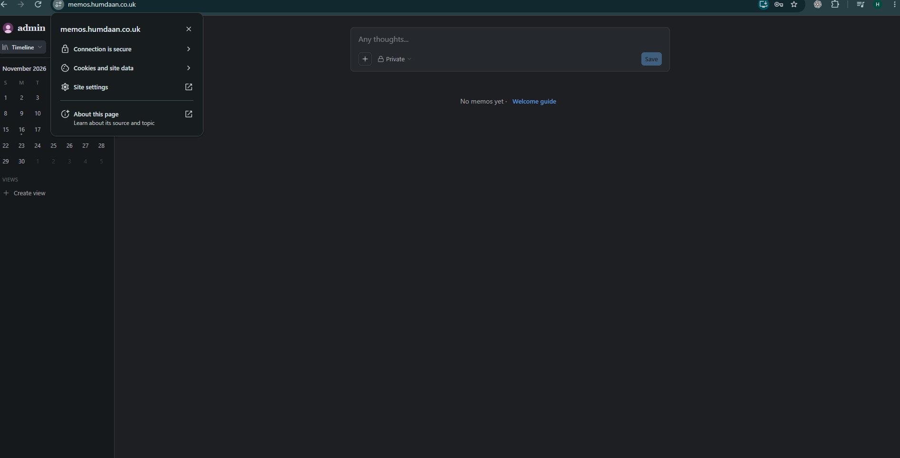
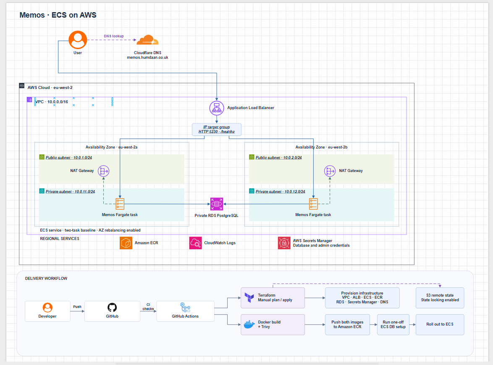
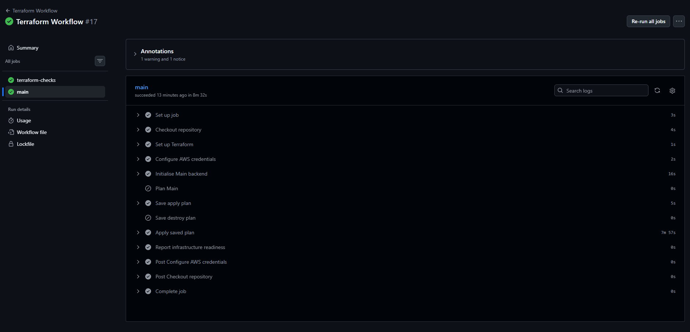
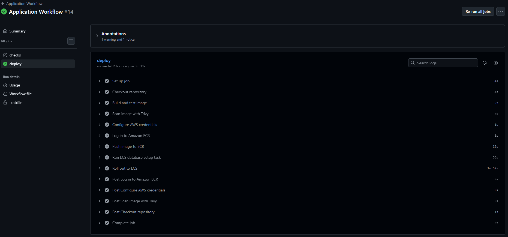

# Memos on Amazon ECS

I deployed [Memos](https://github.com/usememos/memos), an open-source Markdown notes app, on Amazon ECS Fargate. The infrastructure and deployment pipeline are my work. The application image comes from the Memos maintainers.

I wanted to see what happened to a note when ECS replaced the task that served it. I saved a private note with an image, redeployed the service and opened both again after the new tasks came up.

## The application

Memos lets you write Markdown notes and attach files. The deployment is at [memos.humdaan.co.uk](https://memos.humdaan.co.uk) when the stack is running. The site uses sign-in and public registration is disabled.

## How it fits together

Cloudflare resolves the hostname directly to an internet-facing Application Load Balancer in AWS London. The ALB terminates HTTPS and forwards requests to healthy Fargate tasks in private subnets across two Availability Zones. The tasks share a private RDS PostgreSQL database for notes and attachments, so either task can serve the data. PostgreSQL is Single-AZ. The app tier can tolerate losing a task, while the database remains a single point of failure.

[Editable draw.io diagram](documentation/architecture/architecture-diagram-V5.drawio)

## How a release goes live

- **Terraform Workflow** checks the configuration and handles manual plan, apply and destroy. Bootstrap sets up S3 remote state and the IAM role assumed by GitHub Actions through OIDC. The main apply provisions the stack and creates the ECS service at zero tasks.
- **Application Workflow** builds and smoke-tests the pinned Memos image, scans it with Trivy and pushes the app and setup images to ECR. A temporary Fargate task prepares PostgreSQL, writes the app connection string to Secrets Manager and configures the Memos website admin. ECS then starts the app tasks. The pipeline checks the running image digest and the public /healthz endpoint.

## Run it yourself

With Docker running, run these commands in order from the repository root.

- **bash scripts/build-image.sh memos:local**
- **bash scripts/check-container.sh memos:local**

For AWS, configure your domain, Cloudflare settings and GitHub OIDC trust, apply bootstrap, then run **Terraform plan → apply → Application deploy**. The [deployment guide](documentation/cicd-overview.md) lists the repo-specific values to change and explains redeployment and teardown.

## Further documentation

- [System design](documentation/system-design.md) covers shared storage, task replacement and scaling.
- [Networking](documentation/networking.md) traces DNS, HTTPS and private database access.
- [Security](documentation/security-overview.md) explains IAM, secret handling and the network controls.
- [CI/CD and deployment](documentation/cicd-overview.md) walks through bootstrap, both workflows and teardown.
- [Future improvements](documentation/future-improvements.md) covers changes I would make for a longer-running deployment.
